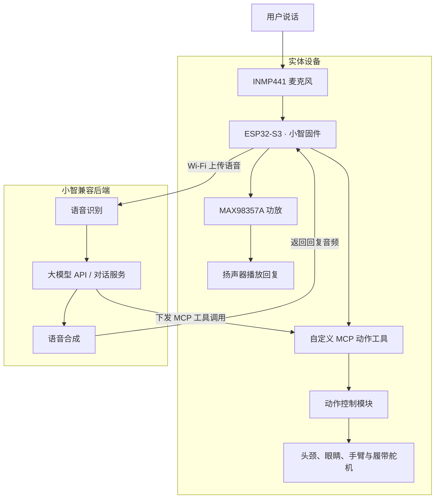

# 小智瓦力机器人项目框架

> [!TIP]
> **这是一个开源项目复现与适配项目。** 基于 [小智 ESP32](https://github.com/78/xiaozhi-esp32) 与现有瓦力制作资料，先复现联网语音聊天，再适配瓦力动作与遥控。本文记录实施框架，功能完成情况以实际验证为准。

  
  &nbsp;&nbsp;
  
  &nbsp;&nbsp;
  
  &nbsp;&nbsp;
  
  &nbsp;&nbsp;
  

## 1. 概览

制作一个以 ESP32-S3 和小智 ESP32 为基础的实体聊天机器人，支持 Wi-Fi 联网、语音输入、后端 AI 对话和语音播放。先完成轻量聊天机器人，再逐步装入瓦力模型并加入动作与遥控。

当前阶段：资料研究与硬件选型，尚未完成采购、固件开发和实物测试。

## 2. 范围

### 轻量聊天机器人

- 联网与配网。
- 麦克风收音、后端识别与 AI 回复、扬声器播放。
- 使用选定板型和固件支持的按键交互；唤醒词能力按实际方案验证。
- 验证后端支持的模型、音色、语音识别和语音合成服务。
- 屏幕可选，第一版不依赖瓦力机械结构。

### 瓦利实体

- 将已验证的语音模块装入机身。
- 加入头颈、眼睛、手臂和履带动作。
- 通过小智 MCP 工具调用有限、明确的动作。
- 在机械安装后重新确认角度、供电、收音和出声效果。

### 后续

安卓遥控、摄像头、视觉交互、自定义动作和状态显示

## 3. 整体架构

| 路线 | 数据流 |
| --- | --- |
| 语音对话 | 用户 → 麦克风 → 小智设备端 → 后端识别与对话 → 语音合成 → 设备播放 |
| 动作执行 | 后端工具调用 → 设备端 MCP 工具 → 动作控制模块 → 舵机 |

图中是拟采用的语音识别、大模型、语音合成链路。动作工具与舵机控制属于后续开发部分，尚未实现。

ESP32-S3 是语音与设备控制终端，大模型不在板上运行。模型 API 通常由兼容后端接入；不能假定把任意 API 地址和密钥填进固件即可使用。

本框架以本地资料中的 ESP32-S3 单板方案为基础，不沿用早先 Gitee 项目的树莓派＋Arduino 架构。

## 4. 硬件模块

| 模块 | 当前候选或资料规格 | 作用 | 当前处理 |
| --- | --- | --- | --- |
| 主控 | ESP32-S3 N16R8 开发板 | 联网、音频、交互与动作调度 | 核实准确板型后确定 |
| 麦克风 | INMP441 | 采集语音 | 第一阶段使用 |
| 功放 | MAX98357A 类 I2S 模块 | 驱动扬声器 | 第一阶段使用 |
| 扬声器 | 清单标注 4Ω、3W | 播放回复 | 核对功放与实际模块匹配 |
| 供电 | 第一阶段使用匹配开发板的 USB 供电 | 台架验证 | 暂不接入电池与舵机电源 |
| 关节舵机 | MG90S 180°，6 个 | 颈部、手臂、眼睛动作 | 第二阶段使用 |
| 履带舵机 | MG90S 360°，2 个 | 左右履带驱动 | 第二阶段单独验证 |
| 电池系统 | 清单为 1S2P 电池及两个 5V 充放电模块 | 移动供电 | 型号、保护及负载能力待核实 |
| 开关及线材 | 自锁开关、触摸开关、杜邦线等 | 操作与连接 | 补齐接线与固定方案 |
| 瓦力模型 | 本地四张结构参考图 | 外壳、传动与安装 | 3D打印 |

## 5. 软件模块

| 模块 | 职责 |
| --- | --- |
| 板级配置 | 引脚、音频、按键、可选显示和外设初始化 |
| 网络连接 | 配网、连接后端、断线重连 |
| 语音交互 | 收音、音频传输、播放及交互状态管理 |
| 后端服务 | 模型、语音识别、语音合成与工具调用 |
| 动作控制 | 舵机输出、校准参数、限位、动作队列和停止逻辑 |
| MCP 工具 | 将转头、抬手、预设动画等包装成可调用功能 |
| 遥控适配 | 后续按明确协议处理遥控命令 |

动作和网络回调应通过队列或任务交接，避免长时间动作阻塞语音交互。遥控和 AI 动作共用统一动作入口，明确优先级；停止命令优先。

## 6. 资料中的引脚记录

以下是原图记录及纸面核对结果，**不是可直接照接的最终接线图**。实际固件版本、开发板和供电确认后，才能发布最终接线表。

### 音频

| 外设信号 | ESP32-S3 GPIO |
| --- | --- |
| 麦克风 WS | 4 |
| 麦克风 SCK | 5 |
| 麦克风 SD | 6 |
| 功放 DIN | 7 |
| 功放 BCLK | 15 |
| 功放 LRC | 16 |

这组音频信号引脚与核查时小智的 [bread-compact-wifi/config.h](https://github.com/78/xiaozhi-esp32/blob/main/main/boards/bread-compact-wifi/config.h) 中的 SIMPLEX 配置一致；不代表整个板型、无屏配置、按键和动作已适配。

### 动作

| 动作部位 | 原图 GPIO |
| --- | --- |
| 左履带 | 14 |
| 右履带 | 13 |
| 脖子上下 | 12 |
| 脖子左右 | 11 |
| 左手 | 10 |
| 右手 | 9 |
| 左眼 | 46 |
| 右眼 | 3 |

移植前重新检查 GPIO 的输入输出能力、启动约束与外设冲突；必要时改线或使用合适的舵机驱动模块。不能假定原图的每个针脚都适合直接驱动舵机。

## 7. 动作接口设计

以下为计划新增的接口名称，不是小智现成的瓦力功能。

| 接口示例 | 行为 | 约束 |
| --- | --- | --- |
| `self.walle.head_turn` | 头部左右转动 | 仅允许校准后的范围 |
| `self.walle.arm_raise` | 抬起指定手臂 | 使用预设安全姿势 |
| `self.walle.play_animation` | 播放预设动作 | 仅接受已实现的动作编号 |
| `self.walle.drive` | 低速、限时移动 | 速度和持续时间设上限 |
| `self.walle.stop` | 停止履带并取消待执行移动 | 本地停止不依赖云端返回 |

连续旋转舵机通过中位附近的脉宽控制停止、方向与速度，不能当作位置舵机指定转角。左右履带分别校准停止值；没有传感器反馈时，不承诺精确移动距离。

## 8. 固件接入路线

### 优先核实原工程

取得作者源码，确认是否已经基于小智以及对应版本。若已集成语音与动作，优先理解并修改现有工程，保留其校准及遥控逻辑。

### 源码无法取得时

以已支持的 ESP32-S3 小智板型配置为起点，完成音频适配，再重新实现动作模块。原固件 BIN 可用于恢复原功能，但不能像源码一样直接加入功能。原 APK 的协议没有确认前，不承诺兼容。

不要直接刷入通用固件后期待原动作和遥控仍然存在。烧录前保存可恢复的原始固件及明确的版本信息。

## 9. 实施与验收

| 阶段 | 工作内容 | 完成标准 |
| --- | --- | --- |
| A：资料补齐 | 板型、完整固件、源码及供电模块信息 | 能明确选择烧录方案和接线方案 |
| B：纯语音台架 | USB 供电，仅接主控和音频 | 多轮收音与播放正常，重启后可重新连接 |
| C：一个关节 | 单独验证舵机输出并校准 | 可控、能停止、不碰撞、不引起主控重启 |
| D：整机动作 | 逐项接入关节与履带 | 限位有效，停止优先，移动超时能停 |
| E：实体安装 | 固定、走线、供电与声学检查 | 关节不拉线，收音播放正常，负载下供电稳定 |
| F：可选遥控 | 核实或重写遥控协议 | 遥控与语音指令不会相互争抢 |

先在机身外验证，舵机校准后再装摇臂或连接负载。使用 Mac 烧录时选择支持 macOS 的工具和匹配固件，不使用资料中的 Windows EXE。

## 10. 供电与可替换设计

- 语音主控和舵机分支分别核算供电，舵机电流不通过开发板小电流供电路径。
- 信号参考地和电源接法按最终模块规格确认。
- 电池保护、充电、升压、负载输出和 USB 同时接入关系必须核实；暂不照搬未确认模块的供电图。
- 采用可拆支架和标注清楚的插接线，记录每个接口的电压、极性与信号。
- 模块替换同时核对电压、电平、引脚、协议和固件支持；同形插头不等于兼容。

## 12. 资料与文件

结构图：[正面](</Users/wangqi/Desktop/机器人3视图/1.png>) · [侧面](</Users/wangqi/Desktop/机器人3视图/2.png>) · [背面](</Users/wangqi/Desktop/机器人3视图/3.png>) · [俯视](</Users/wangqi/Desktop/机器人3视图/4.png>)。

### 在线仓库与技术资料

| 项目或文档 | 用途 | 链接 |
| --- | --- | --- |
| 小智 ESP32 主仓库 | 设备端固件及板型适配 | [78/xiaozhi-esp32](https://github.com/78/xiaozhi-esp32) |
| 小智音频引脚配置 | 比对当前音频接线 | [bread-compact-wifi/config.h](https://github.com/78/xiaozhi-esp32/blob/main/main/boards/bread-compact-wifi/config.h) |
| 小智 MCP 扩展文档 | 注册设备动作工具 | [docs/mcp-usage.md](https://github.com/78/xiaozhi-esp32/blob/main/docs/mcp-usage.md) |
| 早期瓦力制作仓库 | 参考机械结构与另一套控制方案 | [Roboen／瓦力机器人制作](https://gitee.com/roboen/wally-robot-manufacturing) |

