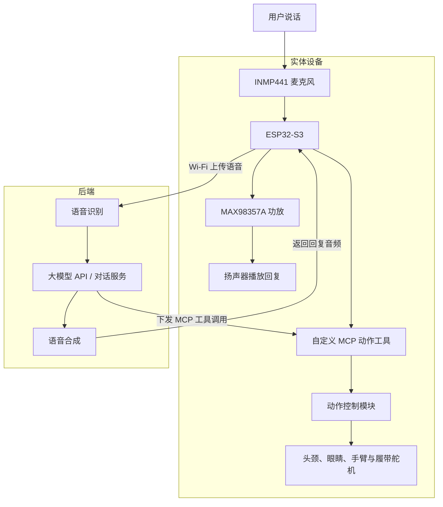

> [!TIP]
> **这是基于开源项目复现。** 通过 [小智 ESP32](https://github.com/78/xiaozhi-esp32) 与现有瓦力制作资料以及网络上出现的机器人开源资料制作的瓦力机器人。

## 概览

制作一个以 ESP32-S3 和小智 ESP32 为基础的实体聊天机器人，支持 Wi-Fi 联网、语音输入、后端 AI 对话和语音播放。先完成轻量聊天机器人，再逐步装入瓦力模型并加入动作与遥控。

| 导航 | 入口 |
| --- | --- |
| 结构参考 | [进入](./images/) |
| 硬件图纸 | [进入](./hardware/Wllebot_hardware.md) |

## 功能

- 联网与配网。
- 麦克风收音、后端识别与 AI 回复、扬声器播放。
- 按键交互；唤醒词能力。
- 后端支持的模型、音色、语音识别和语音合成。
- 屏幕可显示。

## 整体架构

| 路线 | 数据流 |
| --- | --- |
| 语音对话 | 用户 → 麦克风 → 小智设备端 → 后端识别与对话 → 语音合成 → 设备播放 |
| 动作执行 | 后端工具调用 → 设备端 MCP 工具 → 动作控制模块 → 舵机 |

## 硬件模块

| 模块 | 当前候选或资料规格 | 作用 |
| --- | --- | --- |
| 主控 | ESP32-S3 N16R8 开发板 | 联网、音频、交互与动作调度 |
| 麦克风 | INMP441 | 采集语音 |
| 功放 | MAX98357A 类 I2S 模块 | 驱动扬声器 |
| 扬声器 | 清单标注 4Ω、3W | 播放回复 |
| 供电 | 第一阶段使用匹配开发板的 USB 供电 | 台架验证 |
| 关节舵机 | MG90S 180°，6 个 | 颈部、手臂、眼睛动作 |
| 履带舵机 | MG90S 360°，2 个 | 左右履带驱动 |
| 电池系统 | 清单为 1S2P 电池及两个 5V 充放电模块 | 移动供电 |
| 开关及线材 | 自锁开关、触摸开关、杜邦线等 | 操作与连接 |
| 瓦力模型 | 本地四张结构参考图 | 外壳、传动与安装 |

## 软件模块

| 模块 | 职责 |
| --- | --- |
| 板级配置 | 引脚、音频、按键、可选显示和外设初始化 |
| 网络连接 | 配网、连接后端、断线重连 |
| 语音交互 | 收音、音频传输、播放及交互状态管理 |
| 后端服务 | 模型、语音识别、语音合成与工具调用 |
| 动作控制 | 舵机输出、校准参数、限位、动作队列和停止逻辑 |
| MCP 工具 | 将转头、抬手、预设动画等包装成可调用功能 |
| 遥控适配 | 后续按明确协议处理遥控命令 |

## 引脚位置

### 音频

| 外设信号 | ESP32-S3 GPIO |
| --- | --- |
| 麦克风 WS | 4 |
| 麦克风 SCK | 5 |
| 麦克风 SD | 6 |
| 功放 DIN | 7 |
| 功放 BCLK | 15 |
| 功放 LRC | 16 |

音频信号引脚与小智的 [bread-compact-wifi/config.h](https://github.com/78/xiaozhi-esp32/blob/main/main/boards/bread-compact-wifi/config.h) 中的 SIMPLEX 配置一致

### 动作

| 动作部位 | 原图 GPIO |
| --- | --- |
| 左履带 | 14 |
| 右履带 | 13 |
| 脖子上下 | 12 |
| 脖子左右 | 11 |
| 左手 | 10 |
| 右手 | 9 |
| 左眼 | 46 |
| 右眼 | 3 |

## 动作接口设计

| 接口示例 | 行为 | 约束 |
| --- | --- | --- |
| `self.walle.head_turn` | 头部左右转动 | 校准后的范围 |
| `self.walle.arm_raise` | 抬起指定手臂 | 使用预设 |
| `self.walle.play_animation` | 播放预设动作 | 使用预设 |
| `self.walle.drive` | 低速、限时移动 | 速度和持续时间设上限 |
| `self.walle.stop` | 停止履带并取消待执行移动 | 本地停止不依赖云端返回 |

## 资料与文件

结构图：

| 视图 | 图片 | 参考用途 |
| --- | --- | --- |
| 正面 | [walle-front.png](images/walle-front.png) | 眼睛、机械臂与胸前面板布局 |
| 侧面 | [walle-side.png](images/walle-side.png) | 颈部、手臂与履带比例 |
| 背面 | [walle-back.png](images/walle-back.png) | 背板与电池仓 |
| 俯视 | [walle-top.png](images/walle-top.png) | 整机占地与履带间距 |

### 在线仓库与技术资料

| 项目或文档        | 用途              | 链接                                                                                                                   |
| ------------ | --------------- | -------------------------------------------------------------------------------------------------------------------- |
| 小智 ESP32 主仓库 | 设备端固件及板型适配      | [78/xiaozhi-esp32](https://github.com/78/xiaozhi-esp32)                                                              |
| 小智音频引脚配置     | 比对当前音频接线        | [bread-compact-wifi/config.h](https://github.com/78/xiaozhi-esp32/blob/main/main/boards/bread-compact-wifi/config.h) |
| 小智 MCP 扩展文档  | 注册设备动作工具        | [docs/mcp-usage.md](https://github.com/78/xiaozhi-esp32/blob/main/docs/mcp-usage.md)                                 |
| 瓦利机器人        | 参考的机械结构与另一套控制方案 | [Roboen／瓦力机器人制作](https://gitee.com/roboen/wally-robot-manufacturing)                                                 |

