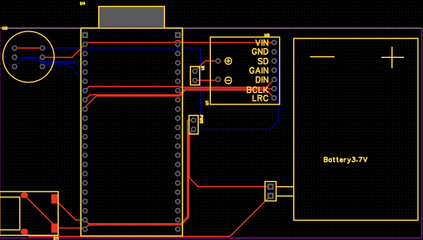

# Hardware

瓦力语音机器人底板的嘉立创 EDA 工程文件。

| 文件 | 内容 |
| --- | --- |
| [walle-mainboard.epro2](./walle-mainboard.epro2) | 嘉立创 EDA 专业版 V3 格式的完整工程归档，包含原理图、PCB 与相关库数据 |
| [pcb-preview.png](./pcb-preview.png) | 当前 PCB 设计预览截图 |

## 打开工程

使用嘉立创 EDA 专业版的“打开工程”入口导入 `walle-mainboard.epro2`。本次导出使用客户端 V4.1.97。

## 当前状态

这是 2026-11-08 的设计稿归档，包含 ESP32-S3 开发板、麦克风、功放、充放电模块及电池相关接口。预览截图仅用于展示布局。

尚未完成实物验证及最终制板检查；充放电模块引脚与实物对应、供电能力、模块孔距和完整 PCB DRC 等仍需核实。本次上传不表示工程已可直接生产。

