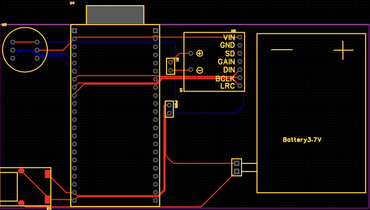

# Hardware

[← 返回项目 README](../README.md)

瓦力语音机器人底板的原理图与 PCB 图纸。

| 文件 | 内容 |
| --- | --- |
| [Wllebot.pdf](./Wllebot.pdf) | 原理图 PDF，1 页 |
| [Wllebot_PCB.pdf](./Wllebot_PCB.pdf) | PCB 图纸 PDF，6 页 |
| [pcb-preview.png](./pcb-preview.png) | 当前 PCB 设计预览截图 |

## 设计稿

这是 2026-11-08 的设计稿归档，包含 ESP32-S3 开发板、麦克风、功放、充放电模块及电池相关接口。预览截图仅用于展示布局。

尚未完成实物验证及最终制板检查；充放电模块引脚与实物对应、供电能力、模块孔距和完整 PCB DRC 等仍需核实。本次上传不表示工程已可直接生产。

