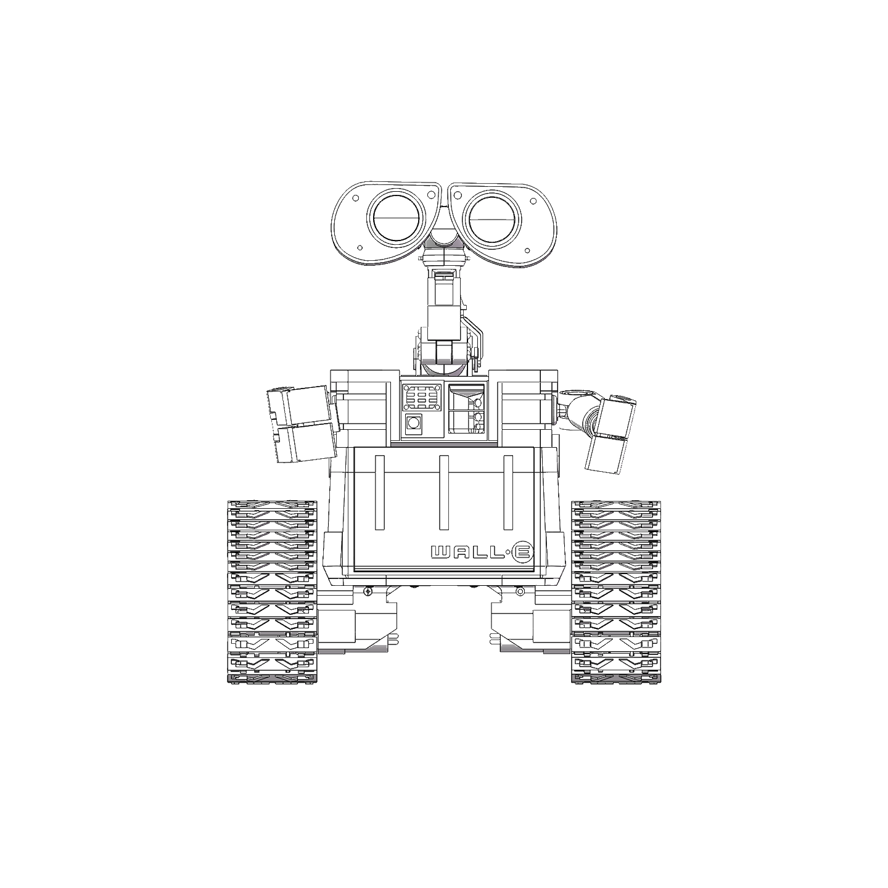
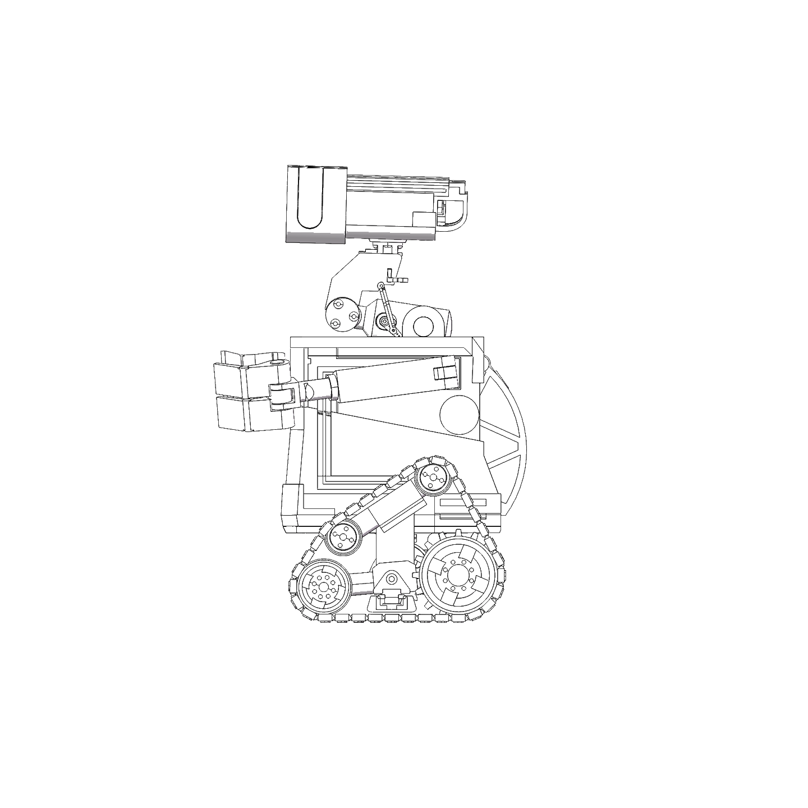
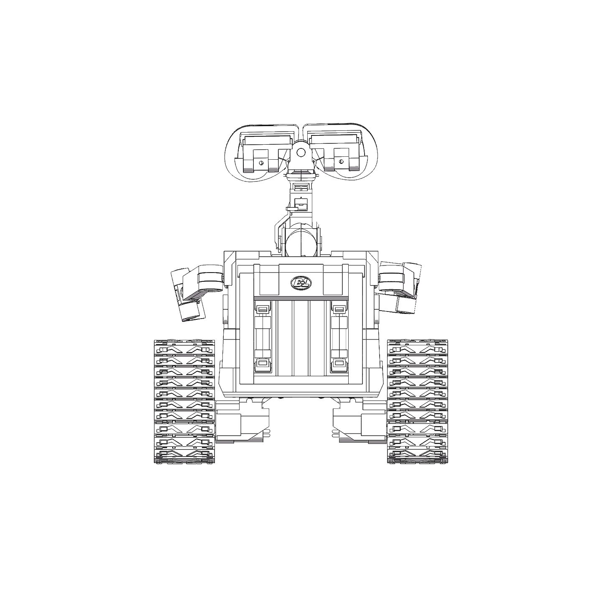
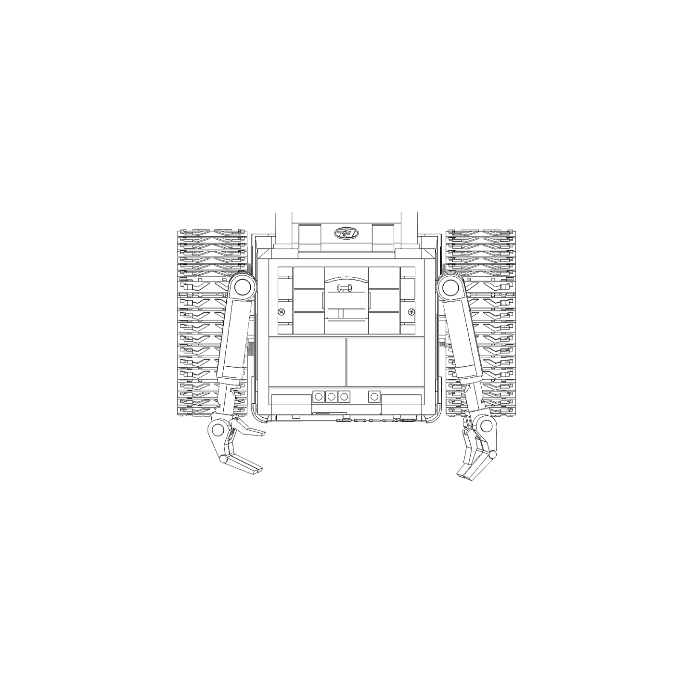

# WALL·E Reference Images

Orthographic reference views of the WALL·E robot used for this project. These drawings guide the
3D-printed shell, the mechanical layout, and the servo placement.

| View | Image | Purpose |
| --- | --- | --- |
| Front | [walle-front.png](images/walle-front.png) | Eyes, arms, and chest panel layout |
| Side | [walle-side.png](images/walle-side.png) | Neck, arm, and track proportions |
| Back | [walle-back.png](images/walle-back.png) | Rear panel and battery compartment |
| Top | [walle-top.png](images/walle-top.png) | Overall footprint and track spacing |

## Front view

## Side view

## Back view

## Top view

---

Part of the [project README](README.md).
