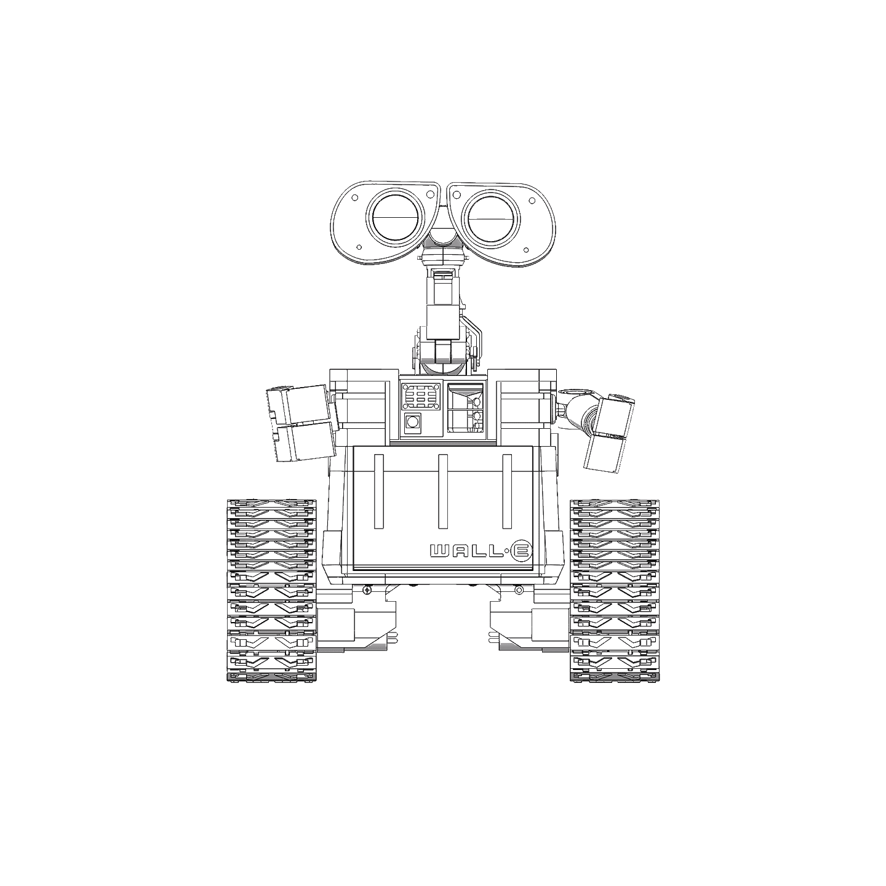
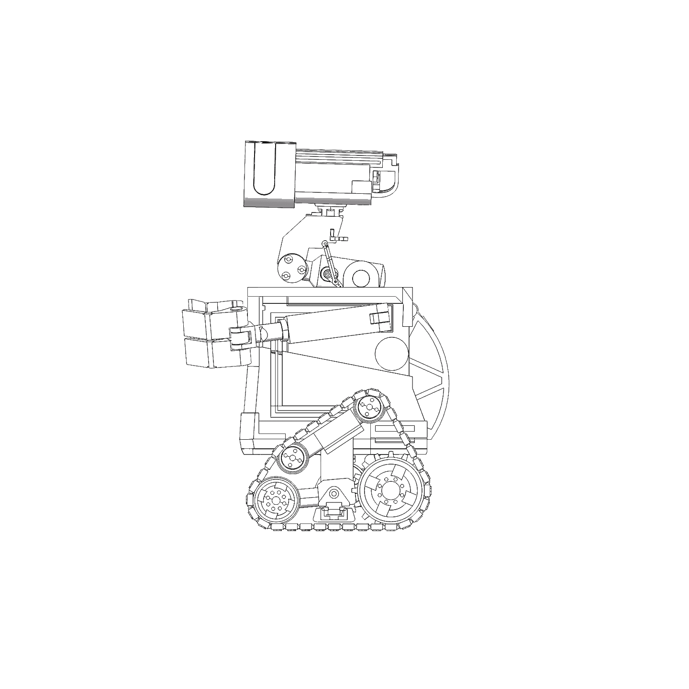
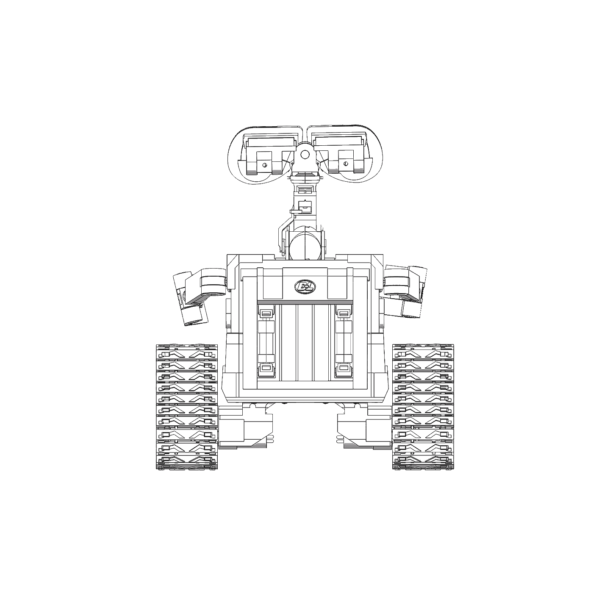
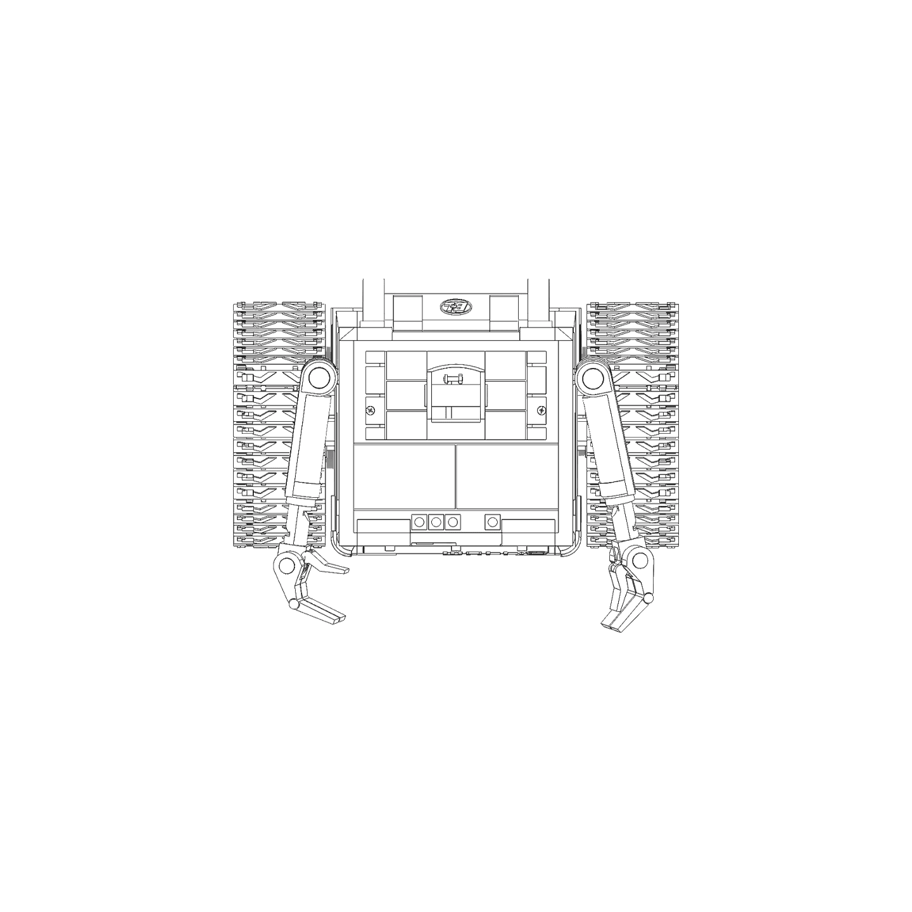

# 瓦力（WALL·E）结构参考图

返回 [项目 README](./README.md)

此为瓦力机器人的正交参考视图

| 视图 | 图片 | 参考用途 |
| --- | --- | --- |
| 正面 | [walle-front.png](images/walle_front.png) | 眼睛、机械臂与胸前面板布局 |
| 侧面 | [walle-side.png](images/walle_side.png) | 颈部、手臂与履带比例 |
| 背面 | [walle-back.png](images/walle_back.png) | 背板与电池仓 |
| 俯视 | [walle-top.png](images/walle_top.png) | 整机占地与履带间距 |

## 正面视图

## 侧面视图

## 背面视图

## 俯视视图

